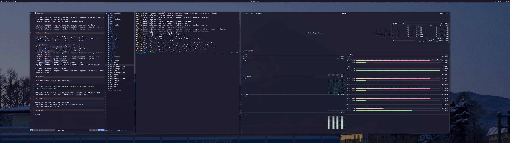
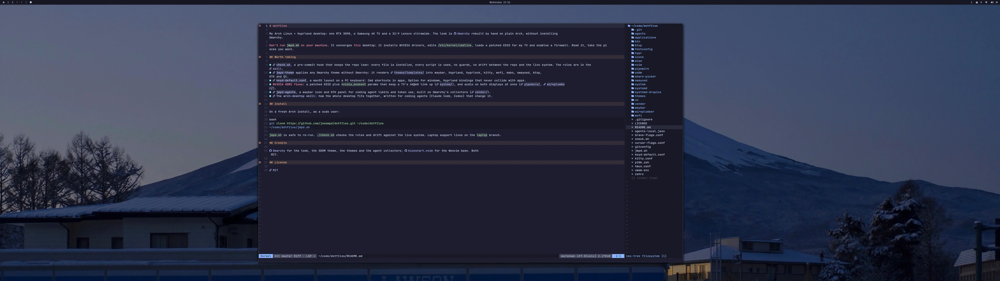
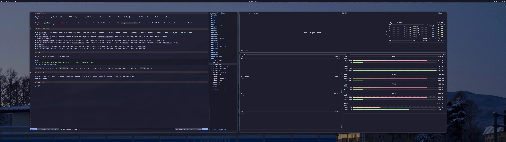
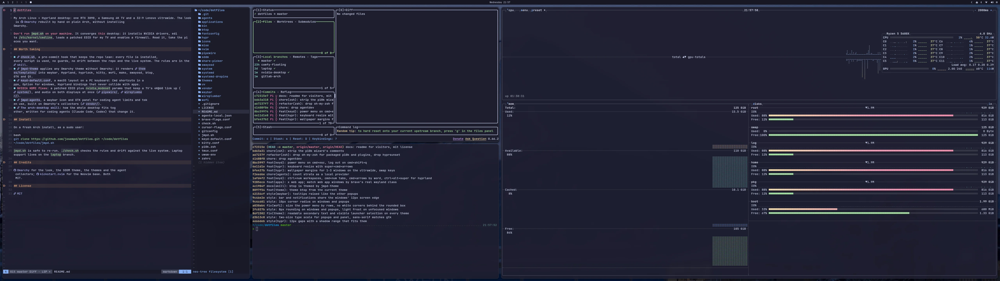
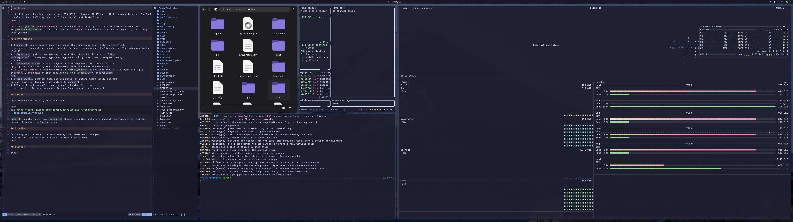
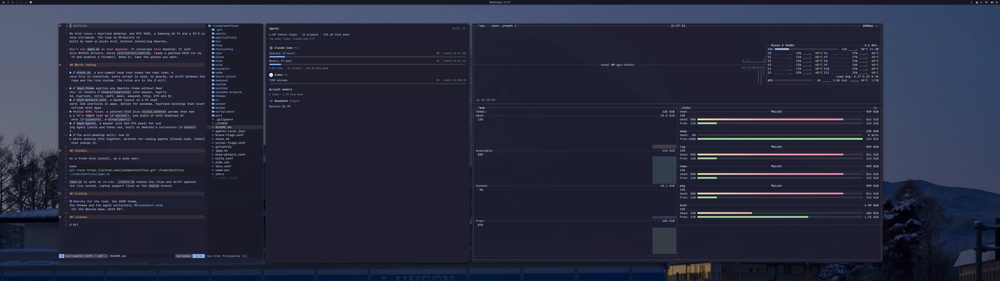
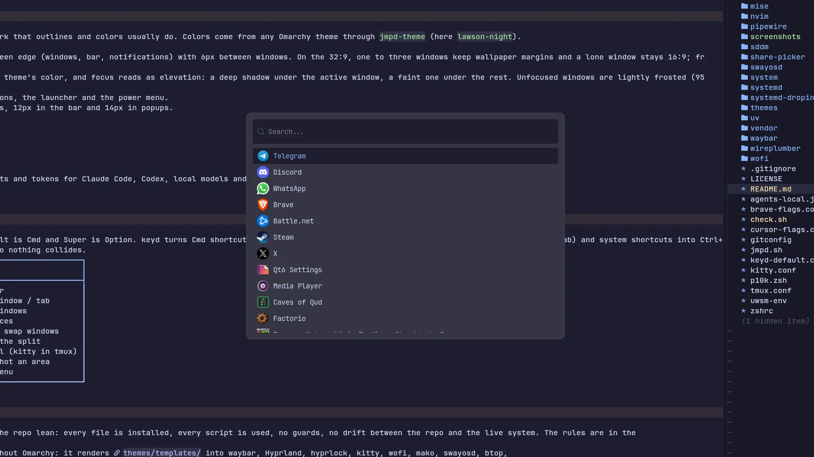
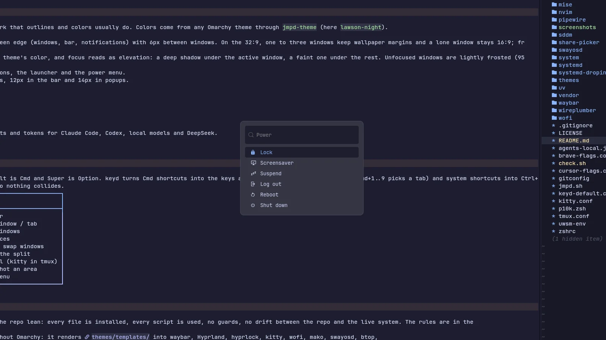
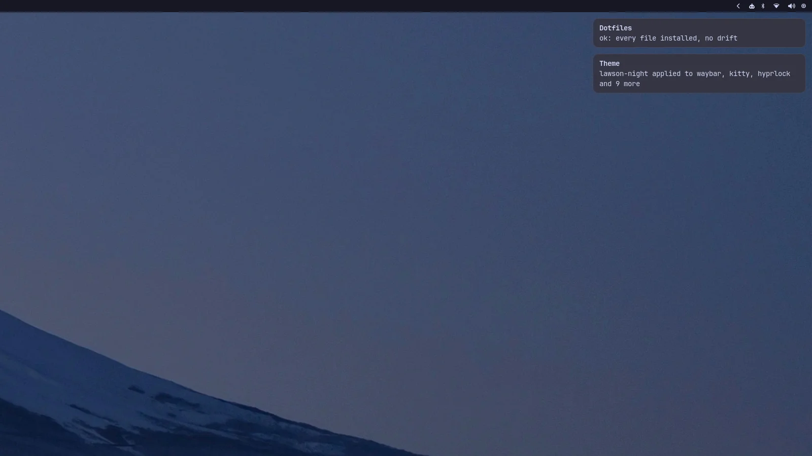

# dotfiles

My Arch Linux + Hyprland desktop: one RTX 3090, a Samsung 4K TV and a 32:9 Lenovo ultrawide. The look is [Omarchy](https://github.com/omacom/omarchy) rebuilt by hand on plain Arch, without installing Omarchy.



**Don't run `jmpd.sh` on your machine.** It converges *this* desktop: it installs NVIDIA drivers, edits `/etc/kernel/cmdline`, loads a patched EDID for my TV and enables a firewall. Read it, take the pieces you want.

## Look

Calm and flat: spacing and shadows do the work that outlines and colors usually do. Colors come from any Omarchy theme through `jmpd-theme` (here `lawson-night`).

- **Spacing**: everything sits 12px from the screen edge (windows, bar, notifications) with 6px between windows. On the 32:9, one to three windows keep wallpaper margins and a lone window stays 16:9; from four windows on they fill the screen.
- **Shadows, not outlines**: a 1px border in the theme's color, and focus reads as elevation: a deep shadow under the active window, a faint one under the rest. Unfocused windows are lightly frosted (95% opacity, soft blur).
- **Round corners**: 10px on windows, notifications, the launcher and the power menu.
- **Type**: JetBrains Mono Nerd Font in two sizes, 12px in the bar and 14px in popups.

| | |
|---|---|
|  |  |
|  |  |

The agents panel (`jmpd-agents`): limits, resets and tokens for Claude Code, Codex, local models and DeepSeek.



| Launcher | Power menu | Notifications |
|---|---|---|
|  |  |  |

**Screensaver and lock**: after 15 minutes idle, every monitor plays a random [terminaltexteffects](https://github.com/ChrisBuilds/terminaltexteffects) animation of the JMPD.SH logo; any key locks. The lock screen (hyprlock) is the blurred wallpaper with the same logo fading down to a plain password box in the theme's colors, and the screen also locks before sleep. The SDDM login uses the logo too.

## Keys

macOS muscle memory on a PC keyboard. Left Alt is Cmd and Super is Option. keyd turns Cmd shortcuts into the keys apps expect (Cmd+C is Ctrl+Insert, Cmd+1..9 picks a tab) and system shortcuts into Ctrl+Alt+Super combos that only Hyprland binds, so nothing collides.

| Keys | Action |
|---|---|
| Cmd+Space | Launcher |
| Cmd+Q / Cmd+W | Close window / tab |
| Cmd+Tab | Cycle windows |
| Ctrl+1..0, Ctrl+Left/Right | Workspaces |
| Super+arrows, Super+Shift+arrows | Focus / swap windows |
| Super+Cmd+arrows | Resize the split |
| Super+Return | Terminal (kitty in tmux) |
| Cmd+Shift+4 | Screenshot an area |
| Cmd+Escape | Power menu |

The full list is in the [skill](agents/skills/arch-desktop/SKILL.md#keyboard-keyd--hyprland).

## Worth taking

- **[`check.sh`](check.sh)**, a pre-commit hook that keeps the repo lean: every file is installed, every script is used, no guards, no drift between the repo and the live system. The rules are in the [skill](agents/skills/arch-desktop/SKILL.md#mvi-rules-minimum-viable-interface).
- **[`jmpd-theme`](bin/jmpd-theme)** applies any Omarchy theme without Omarchy: it renders [`themes/templates/`](themes/templates) into waybar, Hyprland, hyprlock, kitty, wofi, mako, swayosd, btop, GTK and Qt.
- **[`keyd-default.conf`](keyd-default.conf)**, a macOS layout on a PC keyboard: Cmd shortcuts in apps, Option for windows, Hyprland bindings that never collide with apps.
- **NVIDIA HDMI fixes**: a patched EDID plus `nvidia_modeset` params that keep a TV's 4K@60 link up ([`system/`](system)), and audio on both displays at once ([`pipewire/`](pipewire), [`wireplumber/`](wireplumber)).
- **[`jmpd-agents`](bin/jmpd-agents)**, a waybar icon and GTK panel for coding agent limits and token use, built on Omarchy's collectors ([`vendor/`](vendor/omarchy-agents)).
- **[The arch-desktop skill](agents/skills/arch-desktop/SKILL.md)**: how the whole desktop fits together, written for coding agents (Claude Code, Codex) that change it.

## Install

On a fresh Arch install, as a sudo user:

```bash
git clone https://github.com/josempd/dotfiles.git ~/code/dotfiles
~/code/dotfiles/jmpd.sh
```

`jmpd.sh` is safe to re-run. `./check.sh` checks the rules and drift against the live system. Laptop support lives on the `laptop` branch.

## Credits

[Omarchy](https://github.com/omacom/omarchy) for the look, the SDDM theme, the themes and the agent collectors; [kickstart.nvim](https://github.com/nvim-lua/kickstart.nvim) for the Neovim base. Both MIT.

## License

[MIT](LICENSE)
